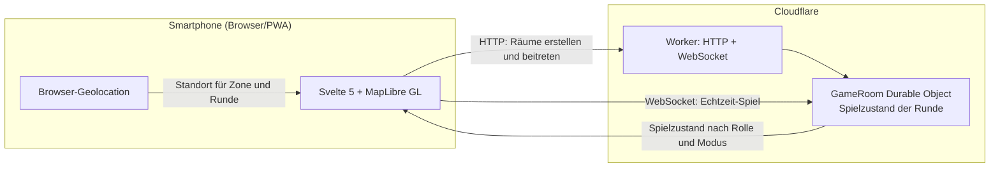

# 🎯 HUNTING – Das Echtzeit-GPS-Fangspiel

> Ein taktisches Outdoor-Geländespiel für Smartphones (PWA) im modernen **„Nachtjagd“**-Design mit Apple Liquid Glass UI, angetrieben von **Cloudflare Durable Objects**, **MapLibre GL** und **Svelte 5**.

[](https://github.com/jojoquark/hunting/actions)
[](https://jojoquark.github.io/hunting)
[](LICENSE)

---

## ⚡ Highlights

- 📱 **PWA für Smartphones:** Läuft im Browser und kann auf iPhone und Android zum Home-Bildschirm hinzugefügt werden.
- 🌐 **Spielregeln im Worker:** Cloudflare Durable Objects verwalten den Raumzustand und prüfen spielrelevante Aktionen. Geräte-Standort kann durch Browser oder Gerät verfälscht werden; HUNTING kann GPS-Spoofing nicht verhindern.
- 📍 **Standortfreigabe:** Der Host-Standort wird zum Einrichten der Zone und während der geöffneten Runde an den Spielserver gesendet. Verlässliche Hintergrundortung und Push-Benachrichtigungen sind derzeit deaktiviert.
- 🗺️ **Nachtjagd-Optik:** Dunkles OpenFreeMap-Vektorkartendesign mit schwebenden Liquid-Glass-Kapseln und taktischem Radar-Puls.
- 🎮 **3 Spielmodi:** Klassisch (Jäger & Gejagte), Zombie (Infektion & Unschärferaster) und Mr. X (ÖPNV-Tickets & Urban Hunt).
- 🧪 **Fähigkeiten und Loot:** Mehrere Fähigkeiten und Loot-Spawns bringen zusätzliche Spieloptionen.

---

## 🏛️ Architektur



## Standort und Hintergrundbetrieb

Der Browser fragt nach Standortzugriff. Der Host-Standort legt die Startzone fest; während der Runde sendet die App Positionen über eine WebSocket-Verbindung an den Cloudflare Worker. Der Durable Object verwaltet den Spielraum und verteilt den Spielzustand abhängig von Rolle und Modus an die Mitspielenden. Standortdaten stammen vom Gerät und sind keine verlässliche Identitäts- oder Sicherheitsprüfung.

Lass HUNTING während der Runde geöffnet und das Display eingeschaltet. Wenn das Betriebssystem die App im Hintergrund anhält, können Standortaktualisierungen ausbleiben. Hintergrund-Push ist derzeit deaktiviert.

---

## 🕹️ Die Spielmodi

### 1. Klassisch (Seeker vs. Hider)
- **Seeker** jagen die **Hider**. Gefangene werden zu Zuschauern.
- Hider werden in regelmäßigen Zyklen per Radar-Ping aufgedeckt.
- Eine schrumpfende Zone treibt die Spieler zusammen. Wer die Zone verlässt, ist sofort live sichtbar!

### 2. Zombie (Infection)
- Startet mit 1 Alpha-Zombie. Jeder gefangene Mensch verwandelt sich sofort in einen Zombie.
- Menschen sehen Zombies live, aber mit einem **50-Meter-Unschärferaster**.
- Wer überlebt bis zum Ende und wird der **„Letzte Mensch“**?

### 3. Mr. X (Urban Scotland Yard)
- Ein unerkannter Mr. X bewegt sich per Bus, Bahn oder zu Fuß durch das Stadtgebiet.
- Detektive sehen die gelösten **Tickets** (Bus, Tram, Bahn, Black Ticket) und müssen Mr. X einkreisen.
- Aufdeckung nach Wahl: nach Tickets, nach gelaufener Distanz oder nach Zeit.

---

## 🛠️ Lokale Entwicklung & Setup

### Voraussetzungen
- Node.js $\ge 20$
- pnpm $\ge 9$ (`npm install -g pnpm`)
- Cloudflare Wrangler CLI (`npm install -g wrangler`)

### Installation & Start
```bash
# Repository klonen
git clone https://github.com/jojoquark/hunting.git
cd hunting

# Abhängigkeiten installieren
pnpm install

# Test-Suite ausführen
pnpm test

# Client lokal starten (Svelte 5 PWA auf Port 5173)
pnpm --filter hunting-app dev

# Worker & Durable Object lokal starten
pnpm --filter @hunting/worker dev
```

### Headless Bot-Simulator
Um ein volles Spiel mit 6 automatisierten Spielern ohne Bewegung an der frischen Luft zu testen:
```bash
pnpm --filter @hunting/bot-simulator start
```

### Automatisierte Checks

GitHub Actions fuehrt Typpruefung, Vitest und den PWA-Build aus. Browser-E2E-Tests sind derzeit nicht eingerichtet; die Dateien unter `tests/e2e` laufen als Vitest-Simulationen mit einem In-Memory-Spielraum und pruefen keinen echten Browserablauf.

### Oeffentlicher Deploy

- **PWA:** GitHub Pages muss im Repository auf „GitHub Actions“ als Quelle eingestellt sein. Aenderungen an App, Shared-Code oder Abhaengigkeitsmanifesten auf `main`/`master` bauen und veroeffentlichen die PWA.
- **Worker:** Fuer den automatischen Deploy muessen `CLOUDFLARE_API_TOKEN` und `CLOUDFLARE_ACCOUNT_ID` als GitHub Actions Secrets gesetzt sein. Fehlen sie, bricht der Deploy-Workflow mit einer klaren Fehlermeldung ab.
- **Backend-Adresse der PWA:** Standard ist `wss://hunting-server.jojoquark.workers.dev/ws`. Liegt der Worker unter einer anderen `workers.dev`-Subdomain, die Repository-Variable `HUNTING_WS_URL` (Settings → Secrets and variables → Actions → Variables) auf `wss://hunting-server.<subdomain>.workers.dev/ws` setzen und den Pages-Workflow erneut ausfuehren.

### Release-Checkliste vor der ersten Runde draussen

1. Worker deployen: `cd worker && npx wrangler login && npx wrangler deploy`. Die ausgegebene URL notieren.
2. Pruefen: `curl https://hunting-server.<subdomain>.workers.dev/` antwortet mit `HUNTING Backend API`.
3. Weicht die Subdomain von `jojoquark` ab: `HUNTING_WS_URL` setzen (siehe oben) und „Deploy PWA to GitHub Pages“ neu starten.
4. Auf zwei Handys `https://jojoquark.github.io/hunting/` oeffnen, Standort erlauben, ein Spiel erstellen und per QR-Code beitreten.
5. Waehrend der Runde App geoeffnet und Display an lassen. Bei Funkloch verbindet sich die App automatisch neu; ein Neuladen fuehrt ueber den Spielcode in der Adresse zurueck in dieselbe Runde.

---

## ⚙️ Cloudflare-Konfiguration

Der Worker verwendet ein Cloudflare Durable Object für jeden Spielraum. Für automatische Deploys müssen `CLOUDFLARE_API_TOKEN` und `CLOUDFLARE_ACCOUNT_ID` als GitHub Actions Secrets gesetzt sein. Die Wrangler-Konfiguration und Durable-Object-Migration liegen in `worker/wrangler.toml`.

Die aktuelle Nutzer-App benötigt keine Firebase-Anmeldung oder Firebase-Datenbank. QR-Einladungen funktionieren als Link zum Beitreten. QR-gestützte Fänge und Hintergrund-Push sind deaktiviert.

---

## 📜 Conductor CDD & Qualitäts-Standards

Das Projekt folgt den Prinzipien des **Context-Driven Development (CDD)** und den **Andrej Karpathy Coding Guidelines**:
- `conductor/product.md` – Vollständige Produktvision und Spielregeln.
- `conductor/tech-stack.md` – Technische Entscheidungen und Schnittstellen.
- `conductor/workflow.md` – TDD-Zyklus und Emil Kowalski UI/Motion-Richtlinien.
- `conductor/tracks/hunting-v1/` – Spezifikation und Ausführungsplan für Version 1.0.

---

## 📄 Lizenz
MIT License © 2026 HUNTING Contributors.
