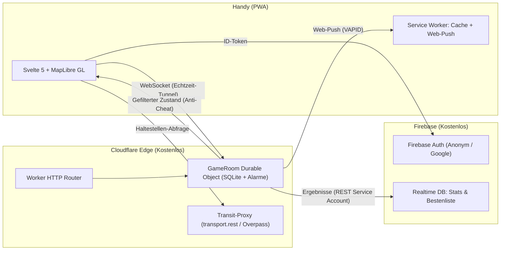

# 🎯 HUNTING – Das Echtzeit-GPS-Fangspiel

> Ein taktisches Outdoor-Geländespiel für Smartphones (PWA) im modernen **„Nachtjagd“**-Design mit Apple Liquid Glass UI, angetrieben von **Cloudflare Durable Objects**, **MapLibre GL** und **Svelte 5**.

[](https://github.com/jojoquark/hunting/actions)
[](https://jojoquark.github.io/hunting)
[](LICENSE)

---

## ⚡ Highlights

- 📱 **Zero-Install PWA:** Läuft direkt im Browser auf jedem iPhone und Android-Gerät – kein App Store, kein Download.
- 🌐 **100% Server-Authoritative:** Cloudflare Durable Objects als Single Source of Truth. Cheating über Browser-DevTools unmöglich.
- 📡 **Funkloch-Mechanik:** Das iOS-Hintergrundlimit wird zum Spielelement – Web-Push vor jedem Ping warnt dich vor der Funkloch-Strafe!
- 🗺️ **Nachtjagd-Optik:** Scharfes, dunkles OpenFreeMap-Vektorkartendesign mit schwebenden Liquid-Glass-Kapseln und taktischem Radar-Puls.
- 🎮 **3 packende Spielmodi:** Klassisch (Jäger & Gejagte), Zombie (Infektion & Unschärferaster) und Mr. X (ÖPNV-Tickets & Urban Hunt).
- 🧪 **10 schaltbare Fähigkeiten & Loot-Spawns:** Tarnkappe, Köder, Störsender, Peilung, Radar, Zonenstoß und mehr.
- 🔄 **Replay & Statistiken:** Interaktiver Match-Rückblick mit Timeline-Scrubbing und Firebase-Bestenliste.

---

## 🏛️ Architektur



---

## 🕹️ Die Spielmodi

### 1. Klassisch (Seeker vs. Hider)
- **Seeker** jagen die **Hider**. Gefangene werden zu Zuschauern.
- Hider werden in regelmäßigen Zyklen per Radar-Ping aufgedeckt.
- Eine schrumpfende Zone treibt die Spieler zusammen. Wer die Zone verlässt, ist sofort live sichtbar!

### 2. Zombie (Infection)
- Startet mit 1 Alpha-Zombie. Jeder gefangene Mensch verwandelt sich sofort in einen Zombie.
- Menschen sehen Zombies live, aber mit einem **50-Meter-Unschärferaster**.
- Wer überlebt bis zum Ende und wird der **„Letzte Mensch“**?

### 3. Mr. X (Urban Scotland Yard)
- Ein unerkannter Mr. X bewegt sich per Bus, Bahn oder zu Fuß durch das Stadtgebiet.
- Detektive sehen die gelösten **Tickets** (Bus, Tram, Bahn, Black Ticket) und müssen Mr. X einkreisen.
- Aufdeckung nach Wahl: nach Tickets, nach gelaufener Distanz oder nach Zeit.

---

## 🛠️ Lokale Entwicklung & Setup

### Voraussetzungen
- Node.js $\ge 20$
- pnpm $\ge 9$ (`npm install -g pnpm`)
- Cloudflare Wrangler CLI (`npm install -g wrangler`)

### Installation & Start
```bash
# Repository klonen
git clone https://github.com/jojoquark/hunting.git
cd hunting

# Abhängigkeiten installieren
pnpm install

# Test-Suite ausführen
pnpm test

# Client lokal starten (Svelte 5 PWA auf Port 5173)
pnpm --filter app dev

# Worker & Durable Object lokal starten
pnpm --filter worker dev
```

### Headless Bot-Simulator
Um ein volles Spiel mit 6 automatisierten Spielern ohne Bewegung an der frischen Luft zu testen:
```bash
pnpm --filter bot-simulator start
```

---

## ⚙️ Cloudflare & Firebase Konfiguration

1. **Cloudflare Worker Secrets:**
   ```bash
   cd worker
   npx wrangler secret put VAPID_PUBLIC
   npx wrangler secret put VAPID_PRIVATE
   npx wrangler secret put FIREBASE_SA
   npx wrangler secret put QR_SECRET
   ```
2. **Firebase Setup:**
   - Projekt im kostenlosen Spark-Tarif anlegen.
   - **Authentication:** Anonym + Google OAuth aktivieren.
   - **Realtime Database:** Standort `europe-west1`, Regeln aus `firebase/database.rules.json` deployen.

---

## 📜 Conductor CDD & Qualitäts-Standards

Das Projekt folgt den Prinzipien des **Context-Driven Development (CDD)** und den **Andrej Karpathy Coding Guidelines**:
- `conductor/product.md` – Vollständige Produktvision und Spielregeln.
- `conductor/tech-stack.md` – Technische Entscheidungen und Schnittstellen.
- `conductor/workflow.md` – TDD-Zyklus und Emil Kowalski UI/Motion-Richtlinien.
- `conductor/tracks/hunting-v1/` – Spezifikation und Ausführungsplan für Version 1.0.

---

## 📄 Lizenz
MIT License © 2026 HUNTING Contributors.
