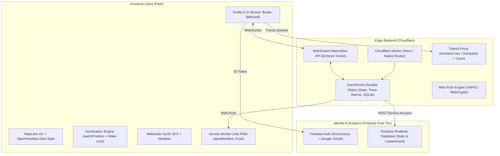

# Tech-Stack: HUNTING

## 1. Architektur-Übersicht



---

## 2. Detaillierte Komponenten-Matrix

| Ebene | Technologie | Version / Standard | Begründung |
| :--- | :--- | :--- | :--- |
| **Monorepo** | pnpm Workspaces | pnpm 9+ | Schlankes Workspace-Management für `shared`, `worker`, `app` |
| **Frontend Framework** | Svelte 5 | 5.x (Runes) | Reaktivität ohne Virtual-DOM-Overhead; blitzschnell auf mobilen Endgeräten |
| **Bundler & PWA** | Vite + `vite-plugin-pwa` | Vite 6+, Workbox InjectManifest | Vollständige Kontrolle über Service Worker Push & Caching |
| **Kartografie** | MapLibre GL JS | 4.x | Freie Vektorkacheln, hochgradig performant, GPU-beschleunigt |
| **Kartenkacheln** | OpenFreeMap | Dark Theme | Kostenlose, schrankenlose Vektorkacheln ohne API-Key |
| **Backend Runtime** | Cloudflare Workers | Node.js Compat | Globale Edge-Infrastruktur, $0 Kosten im Free Tier |
| **Stateful Edge** | Cloudflare Durable Objects | Standard mit SQLite | 1 GameRoom DO pro Spielcode; Single Source of Truth, atomare Alarme |
| **Echtzeit** | WebSocket Hibernation API | RFC 6455 | Minimale Kosten: Schlafende WebSockets zählen kaum ins Request-Budget |
| **Push-Dienst** | Web-Push (VAPID) | RFC 8291 / 8292 | Native Push-Benachrichtigungen über Edge WebCrypto ohne Drittanbieter-SDK |
| **Authentifizierung** | Firebase Auth | v10+ (Web) | Anonymer Sofortstart mit optionalem Google-Konto-Link |
| **Persistenz (Stats)** | Firebase RTDB | europe-west1 | Schreibzugriff nur über Worker Service Account; lesbar für Clients |
| **Validation** | Zod | 3.x | End-to-End Type-Safety für WebSocket-Payloads & Shared Contracts |
| **Testing** | Vitest + Cloudflare Vitest Pool | 2.x | Schnelle Unit-Tests & exakte DO-Emulation im Workers-Pool |
| **E2E & Visuals** | Playwright | 1.48+ | Mobile Viewport Emulation für Safari iOS & Android Chrome |

---

## 3. Verzeichnisstruktur

```
hunting/
├─ shared/                   # Typen, Schemas, Geo- & Spiel-Mathematik
│  ├─ src/
│  │  ├─ typen.ts            # Spieler, Rollen, SpielZustand, Ereignisse
│  │  ├─ protokoll.ts        # Zod-Schemas für Client/Server WebSocket-Nachrichten
│  │  ├─ geo.ts              # Haversine, Peilung, Jitter-Raster, Bounding-Box
│  │  ├─ zone.ts             # Deterministische Zonenplan-Generierung
│  │  ├─ presets.ts          # Spielmodi-Konfigurationen & Standardwerte
│  │  └─ faehigkeiten.ts     # Katalog der 10 Fähigkeiten & Parameter
│  └─ package.json
├─ worker/                   # Cloudflare Worker & Durable Object
│  ├─ src/
│  │  ├─ index.ts            # HTTP-Routing & WebSocket-Upgrade
│  │  ├─ GameRoom.ts         # Durable Object Zustandsmaschine & Alarme
│  │  ├─ sichtbarkeit.ts     # Pure Filter-Engine: sichtbarFuer(spieler)
│  │  ├─ faehigkeiten.ts     # Server-Effekte & Cooldown-Management
│  │  ├─ push.ts             # VAPID Push-Payload-Signierung
│  │  ├─ auth.ts             # JWT-Verifikation via Google JWKS (jose)
│  │  ├─ transit.ts          # Cache-Proxy für Haltestellendaten
│  │  └─ db.ts               # DO SQLite Schema & Queries
│  ├─ wrangler.toml
│  └─ package.json
├─ app/                      # Svelte 5 PWA
│  ├─ src/
│  │  ├─ lib/
│  │  │  ├─ netz/            # WebSocket Client mit Offline-Queue & Reconnect
│  │  │  ├─ ortung/          # Geolocation Manager & Wake Lock
│  │  │  ├─ karte/           # MapLibre Controller & Layer-Management
│  │  │  ├─ ui/              # Liquid Glass & Dark UI Design System
│  │  │  ├─ klang/           # WebAudio Synthesizer & Haptik
│  │  │  └─ i18n/            # Lokalisierung (de.ts, en.ts vorbereitet)
│  │  ├─ screens/            # Start, Lobby, ZoneEditor, SpielHUD, Replay etc.
│  │  ├─ sw.ts               # Service Worker: Push-Event & Assets
│  │  └─ App.svelte
│  ├─ vite.config.ts
│  └─ package.json
├─ tools/bot-simulator/      # Virtuelle Test-Agenten für Headless-Spiele
├─ conductor/                # Conductor CDD Dokumentation & Tracks
└─ README.md
```
